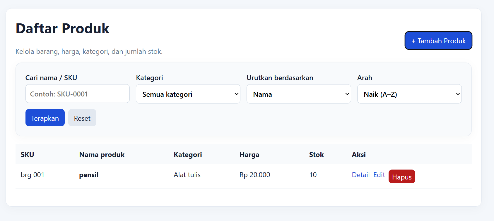
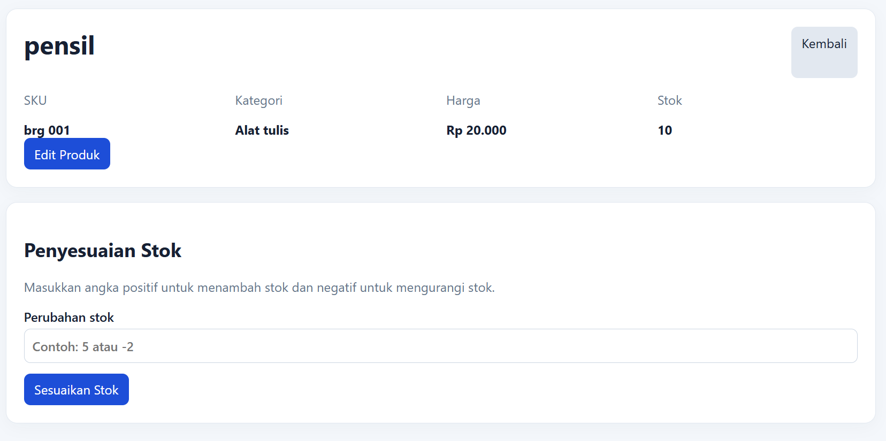
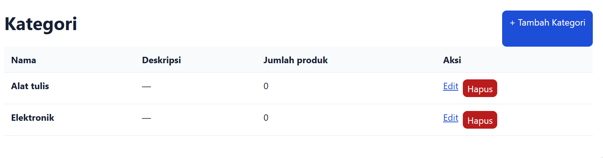
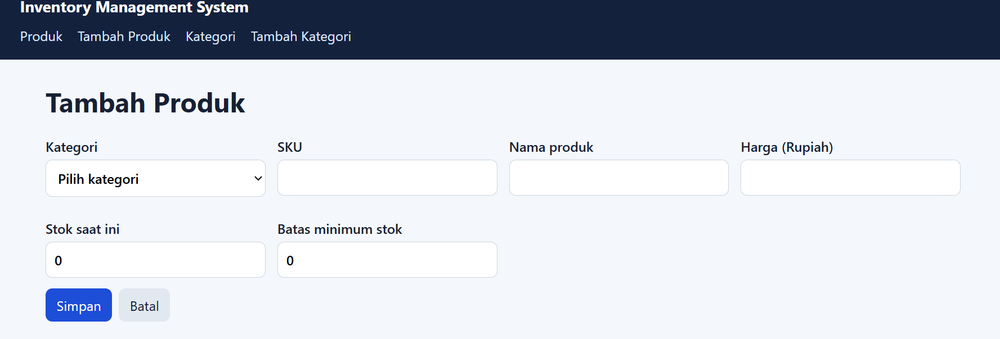
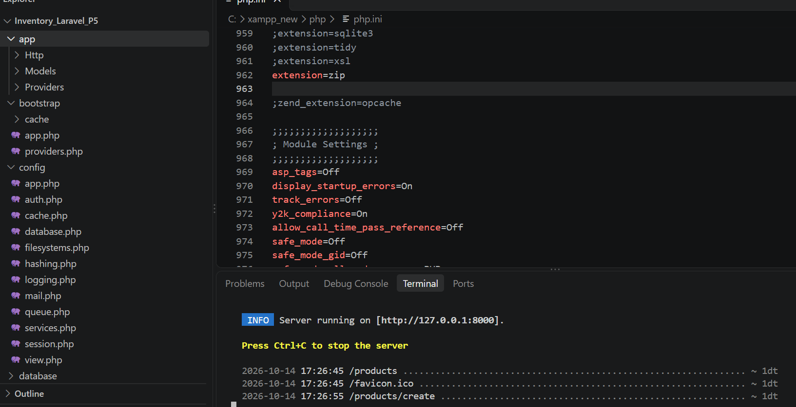

# Inventory Management System — Laravel P5

Starter project untuk tugas Pertemuan 5 berdasarkan materi `Web 5.pptx`: migrasi Inventory Management System ke Laravel, MVC, resource route, Blade, migration, seeder, Eloquent CRUD, relasi kategori-produk, pencarian, filter, sorting, dan pagination.

> **Catatan penting:** file project P4 (PHP native) tidak disertakan saat pembuatan ZIP ini. Karena itu, ini adalah implementasi dasar baru berdasarkan requirement P5, bukan migrasi yang sudah dibandingkan dengan kode P4 milikmu. Aturan stok/fitur khusus P4 harus kamu cocokkan dan pindahkan sendiri jika memang ada.

## Persyaratan
- PHP 8.2+
- Composer 2
- MySQL/MariaDB (misalnya dari Laragon)
- Ekstensi PHP yang dibutuhkan Laravel aktif

## Cara menjalankan setelah diekstrak
1. Ekstrak folder ZIP.
2. Buka terminal di folder `Inventory_Laravel_P5`.
3. Jalankan `composer install`.
4. Salin `.env.example` menjadi `.env` (Windows CMD: `copy .env.example .env`; PowerShell: `Copy-Item .env.example .env`).
5. Buat database MySQL bernama `inventory_db` melalui phpMyAdmin/HeidiSQL.
6. Pastikan nilai database pada `.env` benar.
7. Jalankan `php artisan key:generate`.
8. Jalankan `php artisan migrate:fresh --seed`.
9. Jalankan `php artisan serve`.
10. Buka `http://127.0.0.1:8000`.

## Yang tersedia
- Dashboard ringkas
- CRUD kategori
- CRUD produk (index, create, store, show, edit, update, destroy)
- Validasi form dan pesan kesalahan
- Search nama/SKU, filter kategori, sorting, pagination
- Relasi `Category hasMany Product` dan `Product belongsTo Category`
- Migration, factory, dan seeder
- Blade layout dan reusable alert component
- Pengurangan stok sederhana lewat form penyesuaian stok di halaman detail produk

## Yang perlu kamu selesaikan/cek sebelum dikumpulkan
- Jalankan dan uji project di komputer sendiri; ZIP ini tidak menyertakan `vendor/`.
- Pastikan environment, koneksi database, migration, dan seeder berhasil.
- Ambil screenshot route (`php artisan route:list`), halaman daftar produk, form tambah/edit, validasi, dan detail produk.
- Tulis identitas kelompok/anggota bila diminta dosen.
- Buat dokumentasi singkat arsitektur MVC dan demonstrasi alur form → validasi → simpan → redirect → data tampil.
- **Bandingkan dengan project P4** dan pindahkan business rule/fitur P4 yang belum ada. Saya belum bisa memastikan kesetaraan dengan P4 tanpa source code P4.
- Jangan upload `.env` berisi konfigurasi lokal/rahasia. `.env` sudah masuk `.gitignore`.

## Perintah pengecekan
```bash
php artisan route:list
php artisan migrate:status
php artisan migrate:fresh --seed
```

Jangan menjalankan `migrate:fresh` pada database yang berisi data penting karena perintah ini menghapus tabel lalu membuat ulang.

## Screenshot

### Daftar produk


### Detail produk


### katagori produk 


### tambah produk


### bukti


